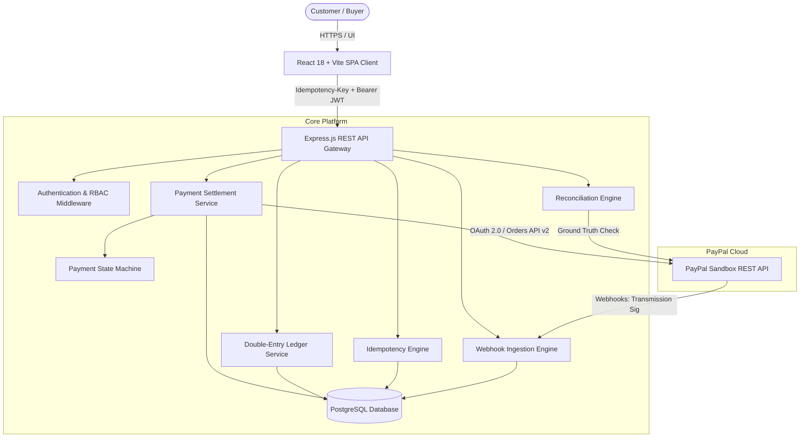
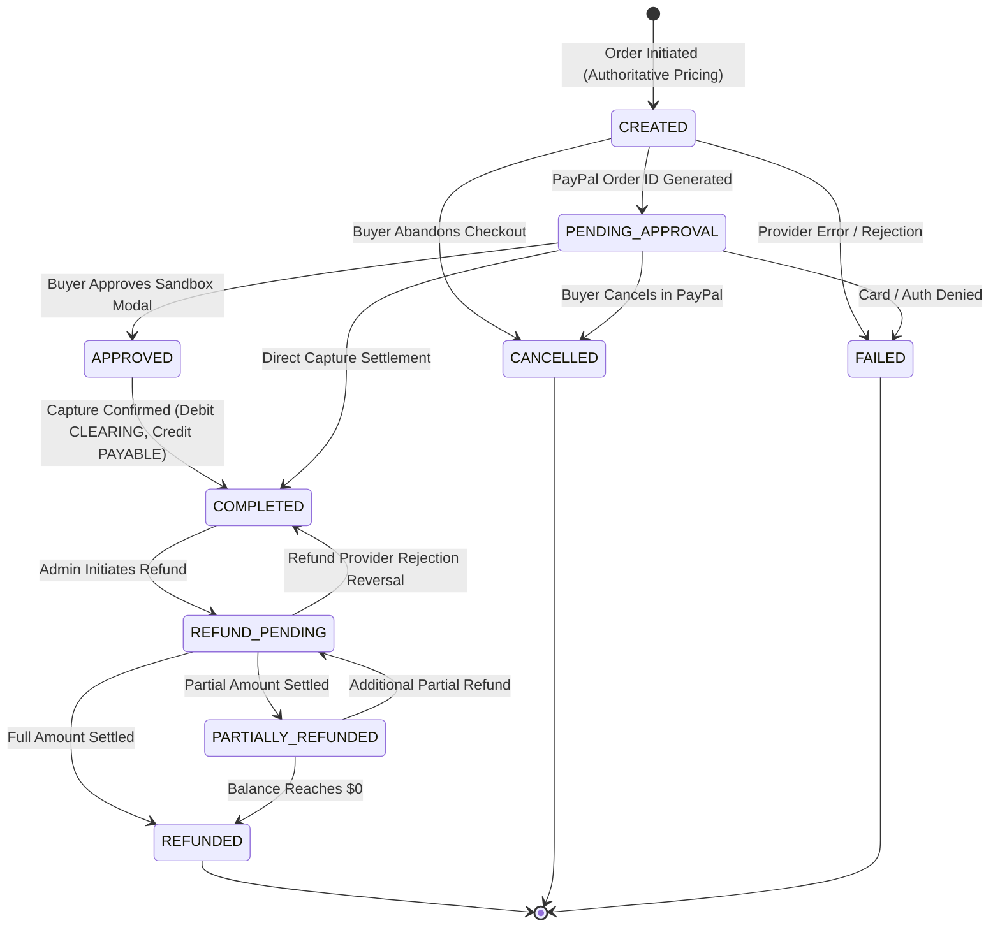
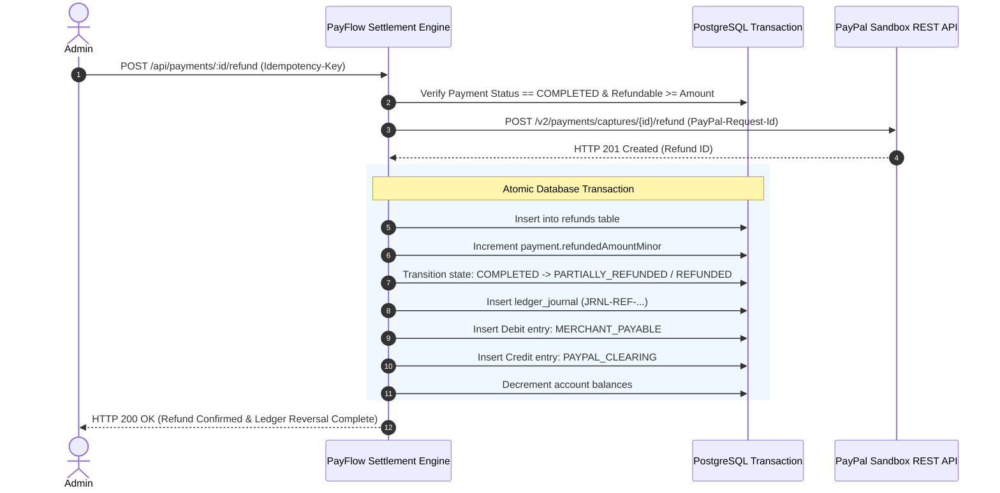
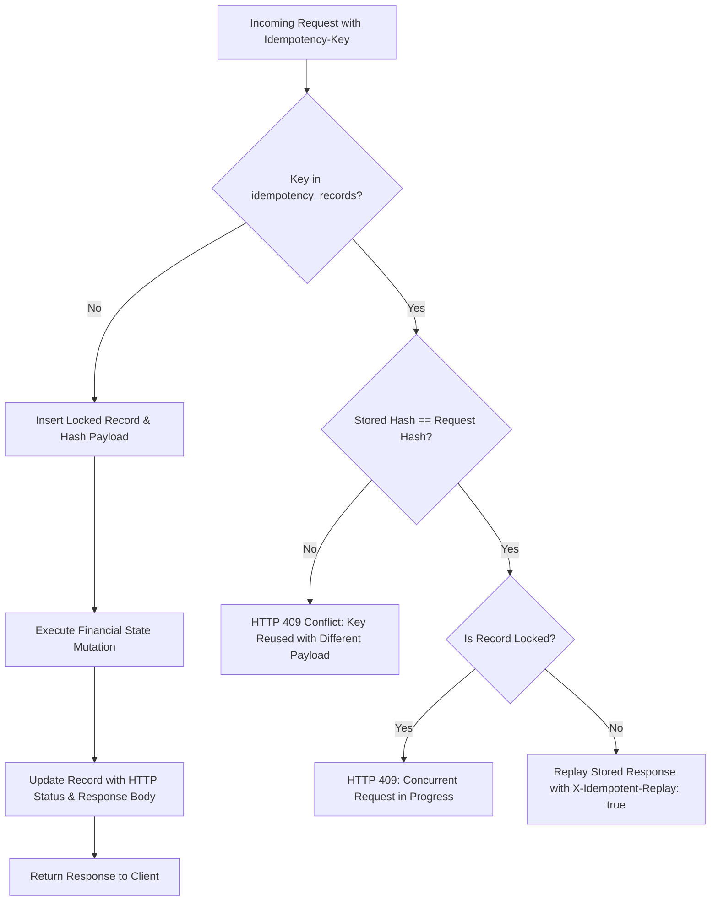

# PayFlow Architecture & System Design

PayFlow is a high-reliability merchant payment processing and reconciliation platform engineered to demonstrate core fintech principles:
- **Authoritative Pricing:** The browser is never trusted with price totals.
- **Double-Entry Financial Accounting:** Every captured payment or refund posts balanced debits and credits across immutable accounts.
- **Strict Idempotency:** State-mutating operations (`orders`, `capture`, `refunds`) require an `Idempotency-Key` header with payload hash validation to prevent double-billing and race conditions.
- **Event-Driven Resilience:** PayPal Webhooks are cryptographically verified, persisted durably, deduplicated on Event ID, and settled asynchronously.
- **Discrepancy Reconciliation:** Automated inspection cross-referencing internal PostgreSQL records against PayPal Sandbox ground truth.

---

## 1. System Architecture Overview

---

## 2. Payment Lifecycle & State Machine

Every payment transitions strictly according to the defined finite state machine. Terminal states (`FAILED`, `CANCELLED`, `REFUNDED`) cannot be overwritten by out-of-order webhooks or delayed events.

---

## 3. Double-Entry Accounting Invariant

Monetary values in PayFlow are calculated and stored exclusively in **integer minor units** (e.g. cents in USD: $29.99 = `2999`), completely avoiding IEEE-754 floating-point inaccuracies.

### The Chart of Accounts

| Account Code | Account Type | Normal Balance | Purpose |
| :--- | :--- | :--- | :--- |
| `PAYPAL_CLEARING` | ASSET | Debit | Tracks gross funds received and held by PayPal. |
| `MERCHANT_PAYABLE` | LIABILITY | Credit | Tracks net funds owed to the merchant for settlement. |
| `REFUND_CLEARING` | ASSET / CONTRA | Debit | Temporary holding for processing settlement adjustments. |

### Journal Posting Rules

1. **Captured Payment ($100.00 = 10000 cents):**
   - **Debit:** `PAYPAL_CLEARING` (+10000)
   - **Credit:** `MERCHANT_PAYABLE` (+10000)
   - **Invariant:** `Sum(Debits) == Sum(Credits) == 10000`

2. **Executed Refund ($40.00 = 4000 cents):**
   - **Debit:** `MERCHANT_PAYABLE` (-4000)
   - **Credit:** `PAYPAL_CLEARING` (-4000)
   - **Invariant:** `Sum(Debits) == Sum(Credits) == 4000`

---

## 4. Idempotency Architecture

All financial endpoints enforce database-backed idempotency using the `Idempotency-Key` header:

